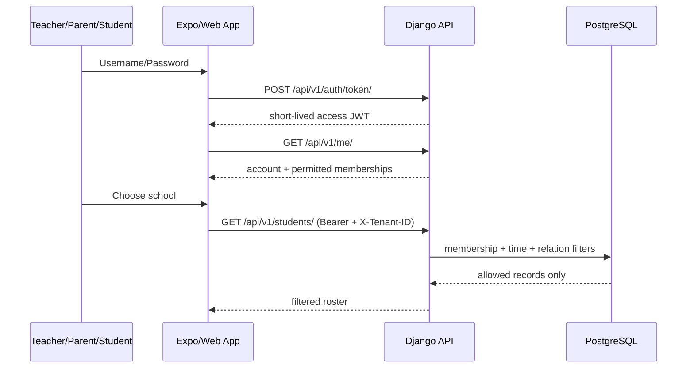

# Architecture Decision Record — Sprint 0 v2

## ADR-001: Ba ứng dụng React Native tách biệt
**Accepted** · Teacher, Parent, Student có bundle id, navigation, UI, phát hành và entitlement riêng. Không chọn 1 mobile app role switch.
Người vừa làm giáo viên vừa là phụ huynh có thể đăng nhập cùng account vào hai app; **quyền luôn xác minh tại backend**.

## ADR-002: React cho web
`admin-web`, `teacher-web`, `platform-console`: React + TS + Vite. Platform console là shell, backend platform APIs chưa tồn tại.

## ADR-003: Shared packages chỉ chứa logic phi UI và hợp đồng
`api-client`, `design-tokens`. Không share React DOM components sang React Native. React web build/navigator tách biệt.

## ADR-004: Giữ Django Modular Monolith
`backend/` kế thừa source v1 và đã bổ sung migrations, validation, CORS, regression tests Sprint 0. `/api/v1/me` trả memberships; `/api/v1/students` bắt buộc `X-Tenant-ID`.
Policy backend kiểm tra quan hệ giáo viên/lớp, guardian/student; việc ẩn nút trên app không phải enforcement.

## ADR-005: Auth prototype có giới hạn
JWT access=15 phút, web giữ access token trong bộ nhớ. Mobile demo lưu short-lived access token trong SecureStore;
chưa có token refresh, MFA, remote revocation, token binding hay OIDC. Khi access hết hạn phải đăng nhập lại.
**Không lưu refresh token, không dùng localStorage, không dùng dữ liệu thật.**
Đánh giá OIDC Authorization Code + PKCE cho mobile; web BFF HttpOnly session trước pilot thật.

## ADR-006: Expo SDK 57 cho baseline
SDK 58 mới phát hành 15/10/2026; bản Expo Go cập nhật 58 chưa phân phối ngay.
SDK 57 hỗ trợ React Native 0.86.3 và React 19.2.3. Chạy `pnpm expo:doctor` và kiểm tra upgrade trước mỗi release.

## ADR-007: Pilot data boundary
Chỉ 1 trường THCS trong pilot vận hành, nhưng có 2 synthetic tenants để chứng minh cách ly.
`compose.mobile-lan.yaml` chỉ mở API qua mạng Wi-Fi riêng trên máy lập trình; không bật công khai và không dùng dữ liệu thật.

## Sequence: login and scoped roster

## Auth/security gates trước data thật
1. Xác thực guardian links và teacher assignment có thời hạn; tenant isolation cả đọc/ghi.
2. MFA roles đặc quyền, TLS và certificate validation, auth token lifecycle/revocation, password policy.
3. CORS chỉ áp dụng web; mobile không phụ thuộc CORS. CORS không phải security boundary.
4. Không log JWT/PII; audit events cho writes; least-privilege Supabase/Auth nếu chuyển provider phải review.
5. Kế hoạch bảo vệ dữ liệu học sinh, DPA, retention, consent và incident response.

## ADR-008: Reproducible builds và session boundaries
Migrations được version trong source; CI không tự tạo migrations. PostgreSQL 17 chạy trong CI và Compose.
Python dependencies pin phiên bản; pnpm 10.18.3 với frozen lockfile. Metro cho ba app dùng port riêng.
`/me/` trả `session_expires_at` để giao diện tự đăng xuất khi hết hạn; backend vẫn xác thực JWT ở mọi request.
Kết quả tải roster bị vô hiệu khi đổi trường/đăng xuất, tránh trả dữ liệu cũ vào ngữ cảnh mới.
CORS cho phép header `X-Tenant-ID` ở các origin development đã định nghĩa.
